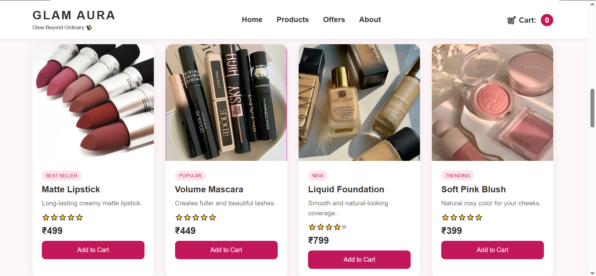
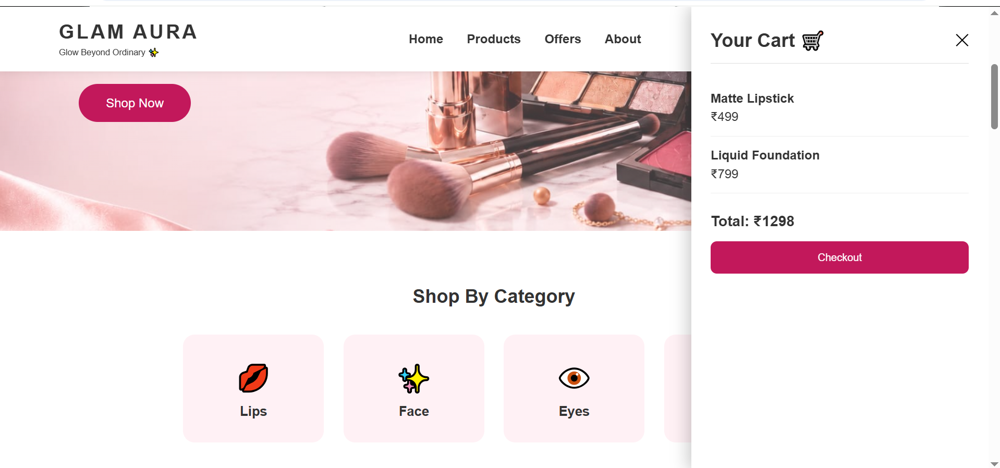
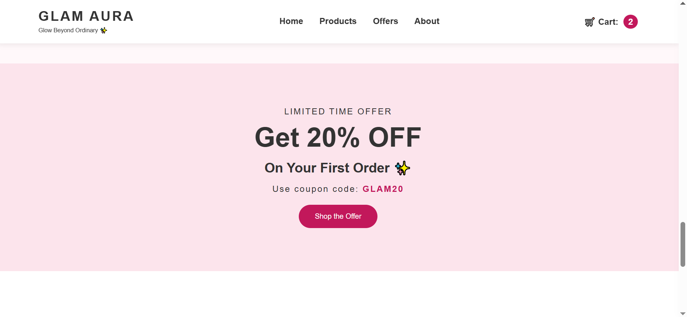
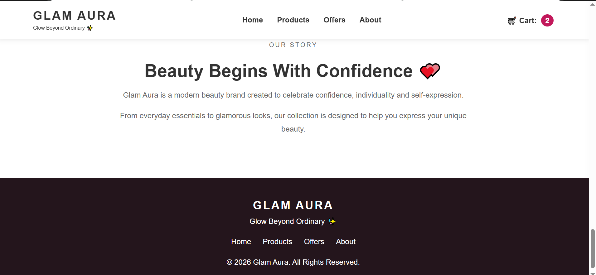

# Glam Aura – Beauty E-Commerce Website

A responsive beauty and makeup shopping website built with **HTML5, CSS3 and JavaScript**. Visitors can browse products, search by name, add items to a cart and see the total update instantly.

## Features
- **Responsive design:** layout adapts to desktop, tablet and mobile screens
- **Sticky header** with navigation links and a live cart item counter
- **Home page** with a hero banner and a "Shop Now" button that scrolls smoothly to the products
- **Shop by Category** section: Lips, Face, Eyes and Beauty Care
- **12 products** with image, tag, description, rating and price in ₹
- **Live search:** products are filtered by name as you type
- **Shopping cart:** a cart panel slides in from the right showing every item, the item count in the header and an automatic total price, with a checkout button
- **Offer banner** (GLAM20 coupon) and **About** section
- **Hover effects** and smooth animations on cards and buttons

## Screenshots

### Home


### Products


### Shopping Cart


### Offers


### About


## Tech Stack
- **HTML5:** page structure and semantic sections
- **CSS3:** Flexbox, Grid, media queries, transitions and a sticky header
- **JavaScript:** DOM manipulation, event handling, array methods and cart logic

## Project Structure
```
Glam-Aura/
├── index.html
├── style.css
├── script.js
├── images/          # product and banner images
└── screenshots/     # screenshots used in this README
```

## How to Run
1. Download or clone this repository.
2. Open `index.html` in any web browser. No installation is needed.

## What I Learned
- Building a responsive layout with Flexbox, Grid and media queries
- Updating the page dynamically with JavaScript (cart, total and search)
- Organising a project into separate HTML, CSS and JavaScript files

## Future Improvements
- Make the category cards filter the products
- Save the cart with `localStorage` so it survives a page refresh
- Add remove-item and quantity controls in the cart
- Apply the GLAM20 coupon discount at checkout

## Author
**Ayesha N**
[LinkedIn](https://linkedin.com/in/ayesha-n-8a5992385) | [GitHub](https://github.com/AyeshaN-07)